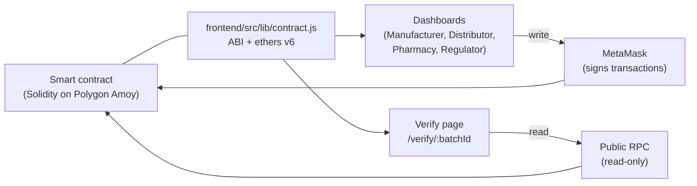
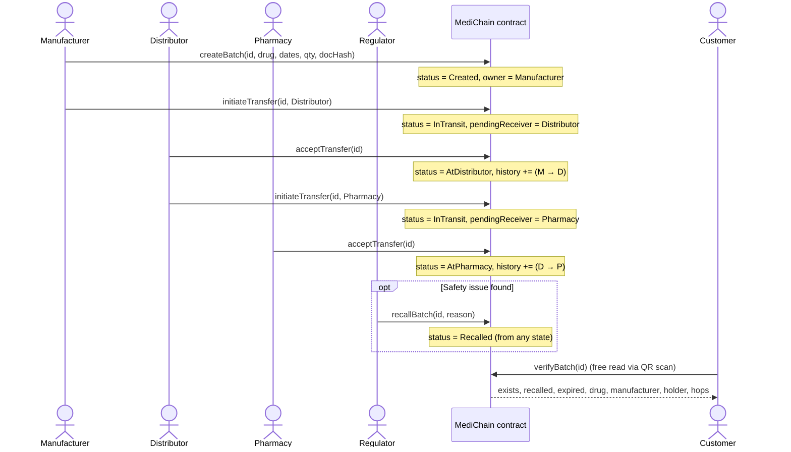
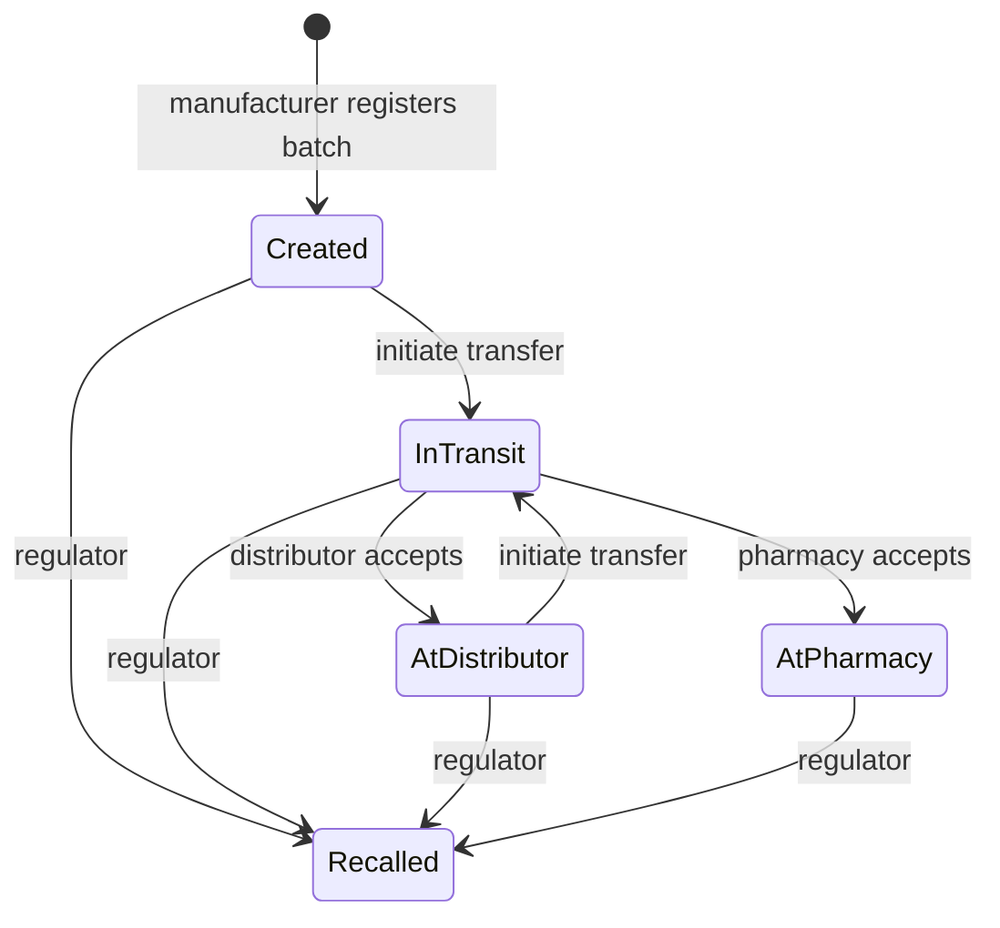

# MediChain architecture

## Layers

- **Writes** (create, transfer, accept, recall) come from the dashboards and are signed in MetaMask by a registered participant. The contract checks the caller's role.
- **Reads** for customers go through a public RPC. `verifyBatch`, `getBatch`, `getHistory` and `participants` are `view` calls: they cost no gas and need no wallet.
- Only a hash of the lab report (`docHash`) is stored on-chain. The file itself lives off-chain (IPFS).

## Custody flow

Every handover takes two steps. The current owner **initiates** a transfer to a named receiver, and the batch becomes `InTransit`. Ownership moves only when that receiver **accepts**. This stops someone from dumping a batch on another participant, and the history records who actually received it.

> Function names for writes are illustrative. The exact names are in Member A's contract under `contracts/`.

## Batch status

## How the verify page decides its verdict

| `verifyBatch` result | Verdict shown |
|---|---|
| `exists == false` | **NOT FOUND**: possibly counterfeit |
| `recalled == true` | **RECALLED**, with the reason from `recallReason(keccak256(batchId))` |
| `expired == true` | **EXPIRED** |
| otherwise | **GENUINE** |

The timeline comes from `getHistory(batchId)`. Its first entry has `from = 0x0`, which means "created by the manufacturer". Each address is turned into a readable name and location with `participants(address)`.
